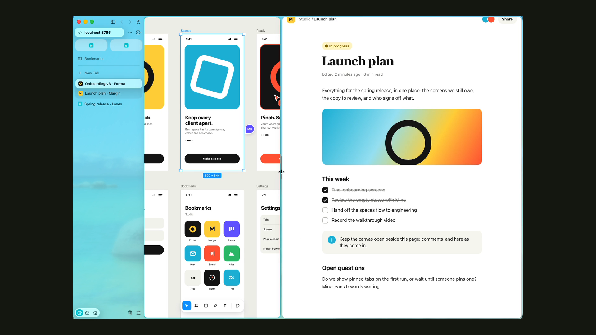

# eGlu feature videos

[Watch the complete showcase](eGlu-showcase.mp4). The ten feature clips below also stand alone, following the visual approach of the eGlu site's [pinned tab](https://github.com/eGlu-dot-app/eGlu-site/blob/main/media/pinned-tab-switch-loop.mp4), [iPad cursor](https://github.com/eGlu-dot-app/eGlu-site/blob/main/media/ipad-cursor-loop.mp4) and [Handoff](https://github.com/eGlu-dot-app/eGlu-site/blob/main/media/handoff-loop.mp4) videos. Each shows real app footage on a plain dark background. There are no title cards, captions, panel graphics, gradients, progress bars, added branding, synthetic hardware frames or instructional overlays. Feature names appear only in MP4 chapters, filenames and this document. The native Mac cursor is visible; no hand illustration was needed.



| Feature | Clip | Native footage |
| --- | --- | --- |
| Desktop web apps | [Mac](features/01-desktop-web-apps.mp4) | Loaded desktop-layout synthetic web app. |
| Tab layouts | [Mac](features/02-tab-layouts.mp4) | Compact tab row, pinned tabs and switching to the sidebar. |
| Split View | [Mac and iPad](features/03-split-view.mp4) | Two live pages and a divider that changes their widths. |
| Spaces | [Mac](features/04-spaces.mp4) | Changing spaces changes the colour and set of tabs. No live sign-in comparison. |
| Command bar | [Mac](features/05-command-bar.mp4) | A typed query finds and opens a bookmark result. |
| Bookmarks | [Mac](features/06-bookmarks.mp4) | A new window opens on Studio's bookmark grid; opening a bookmark loads the page. |
| Little windows | [Mac](features/07-little-windows.mp4) | A local link opens in a compact window; its loaded page scrolls. |
| History | [Mac](features/08-history.mp4) | Filter visited synthetic pages and reopen a result. |
| Developer tools | [Mac](features/09-developer-tools.mp4) | Address and HTTP status; Size changes the viewport. |
| Trackpad View | [iPhone](features/10-trackpad-view.mp4) | Desktop page, native controls, minimap movement, zoom and Exit. |

The complete showcase has a chapter marker for each feature. [The timeline](source/timeline.json) records chapter and source cut boundaries. [The edit list](source/edits.json) records the native source ranges and devices. No new footage was recorded for this presentation-only revision.

## Documentation and implementation

- [Feature documentation](../../README.md#features) and [requirements](../../Docs/Requirements.md) define the scope. Only observed native interactions appear in the video.
- Mac: [`BrowserView.swift`](../../Mac/Sources/BrowserView.swift), [`WindowModel.swift`](../../Mac/Sources/WindowModel.swift), [`Session.swift`](../../Mac/Sources/Session.swift), [`LittleWindow.swift`](../../Mac/Sources/LittleWindow.swift), [`CommandBar.swift`](../../Mac/Sources/CommandBar.swift) and [`DeveloperBar.swift`](../../Mac/Sources/DeveloperBar.swift).
- iPad: [`Browser.swift`](../../App/Sources/Browser.swift), `split(with:)`, `dragDivider(to:)`, `dropDivider()` and `showSpace(_:)`.
- iPhone: [`DesktopPad.swift`](../../App/Sources/DesktopPad.swift), `showDesktopPad()`, `showDesktopHelp()` and `leaveDesktopView()` in the iOS browser.

## Provenance and safety

- Native app recordings, not recreated UI or animated screenshots. Actions play at original speed. Cuts remove pauses and repeated actions, not required outcome evidence. The Mac recorder omitted static tail time in the Developer recording, so that clip uses a derivative with a three-second hold on the actual final frame. No action is generated or interpolated.
- Product source checkpoint: [`0ac99c1`](https://github.com/eGlu-dot-app/eGlu/commit/0ac99c1593fe9fe23e31831f4c5de8505d128987). Bundle identifiers, devices, isolation, source measurements and hashes are in [the manifest](manifest.json).
- Mac uses a separate MarketingQA bundle, defaults domain and data root. `EGLU_DATA_ROOT` also disables `canSync`. Simulators use `net.taehee.safience.MarketingQA`, `EGLU_ISOLATED_QA=1` and their own QA data roots.
- No production container, real workspace, signed-in site or Apple Account. Sync, suggestions and intelligence stay off. Developer mode is enabled only for its chapter, then restored off.
- Forma, Margin, Lanes, Post and Week are synthetic pages on loopback port 8765. Their content is visible only within the actual browser UI. Decorative controls within those test pages are not presented as working third-party products.
- The Mac capture region and simulator screens keep their native proportions on a plain `#161713` canvas. No external bezel artwork is used in these videos. The App Store screenshot frames and previews are a separate deliverable and are unchanged.
- Temporary iOS 27.1-only API guards stay in the separate capture build for the available 27.0 SDK/runtime, not repository app source. See [capture constraints](../AppStore/source/README.md#capture-build).

## Coverage limits

- Peek opened a blank overlay in the isolated Mac test, so it is excluded. Little windows were verified separately and do not imply Peek coverage.
- Chrome extensions, grammar checking, iCloud sync, Apple Intelligence, live sign-in isolation, physical iPad trackpad input and Duo are not demonstrated. Existing-tab and command result types in the command bar were not verified; the clip shows a bookmark result.
- Margin fits in the portrait iPad viewport, so notes scrolling there is not claimed. Scrolling in the Mac little window is a separate verified action.
- No App Store Connect upload or PR merge.

## Reproduction and validation

Follow the [isolated capture process](../AppStore/source/README.md). Simulator sources use `xcrun simctl io <device> recordVideo --codec=h264 <name>.mov`. Mac sources use native window-region screen recordings with the cursor. The manifest records their capture rectangle and hashes. Native movies are local intermediates, not repository assets. Exact reproduction requires those sources; new recordings require new ranges and hashes.

With FFmpeg and the original isolated recordings:

```sh
python3 Marketing/Showcase/source/render.py \
  Marketing/Showcase/source/edits.json /path/to/native-movies /path/to/export
```

The renderer produces the combined MP4, ten individually usable clips, a plain poster and a timeline. Intermediates stay in the export directory. Do not commit source movies. Native UI outcomes and the final edit are reviewed separately. Export checks cover full decode, 1920 by 1080, 30 fps, H.264 High/yuv420p, silent stereo AAC at 48 kHz, fast-start, no added on-screen text or artwork, and chapter timings. The manifest records measured values and SHA-256 hashes. Python compilation, JSON parsing, source ranges and `git diff --check` are also checked.
