<p align="center">
  
</p>

<h1 align="center">Safience</h1>

<p align="center">
  A web browser for iPad and iPhone, made for desktop web apps<br>
  used with a trackpad and a keyboard.
</p>

<p align="center">
  <a href="https://apps.apple.com/app/id6818395717"></a>
</p>

Safience is a WebKit browser for working in web apps such as Figma, a whiteboard, a project board or a CMS. On iPad, sites load their desktop versions, and the trackpad's pinches and scrolling and every ⌘ shortcut go to the page, as they would in Safari on a Mac. On iPhone, the bar sits at the bottom within reach of your thumb, and Desktop View turns the screen into a trackpad for a site's desktop version. Spaces keep each client's sign-ins apart, and iCloud carries your spaces, bookmarks and tabs to your other devices and to Chrome.

No account, no server of ours, no analytics. What Safience keeps stays on your devices, or in your own iCloud if you turn sync on. Besides the pages you open, it asks the internet for only three things: your search engine's suggestions as you type (Settings › Search turns them off), sites' icons, and updated ad-blocking lists.

## Contents

- [Install](#install)
- [Features](#features)
- [Safience Sync for Chrome](#safience-sync-for-chrome)
- [Keyboard shortcuts](#keyboard-shortcuts)
- [FAQ](#faq)
- [Privacy](#privacy)
- [Known limitations](#known-limitations)
- [Build from source](#build-from-source)
- [Contributing](#contributing)
- [Security](#security)
- [Disclaimers](#disclaimers)
- [Credits](#credits)
- [License](#license)

## Install

Get Safience from the [App Store](https://apps.apple.com/app/id6818395717). It is one app for iPad and iPhone.

| Device | Needs | Gets |
|---|---|---|
| iPad | iPadOS 17 or later, and a trackpad and keyboard (Magic Keyboard, Magic Trackpad) to get the most from it | Desktop sites, the trackpad and ⌘ keys for the page, split view, Stage Manager windows |
| iPhone | iOS 17 or later | The bar at the bottom, mobile sites, Desktop View |

- On iOS and iPadOS 26 or later, the bars are in Liquid Glass, and on iPad the menu bar lists every command with its keys.
- With Apple Intelligence on (iOS and iPadOS 26 or later), the address bar also finds tabs, bookmarks and commands by what your words mean.

### First steps

1. **Open Safience.** A welcome sheet asks you to name a first space and give it a colour and an icon, offers to bring in your bookmarks, to make Safience your default browser and to turn on iCloud. Every step can be skipped. There is no account to make.
2. **Open a tab.** Press ⌘T or tap **+**, then type an address, a search, or the name of a tab, a space, a command or a part of Settings.
3. **Find Settings.** On iPad it is at the end of the current tab's menu, or press ⌃⌥, (Control, Option, comma). On iPhone it is at the end of the page's menu (the **…** button). The command bar finds it too.

### Make Safience your default browser

In the Settings app, go to **Apps › Default Apps › Browser App** and choose Safience. Before iOS and iPadOS 18.2, it is **Settings › Safience › Default Browser App**. Safience's own Settings has a button that goes there, and on 18.2 or later says whether Safience already is the default. Links from other apps then open in a new tab.

### Bring your bookmarks

Export them from your old browser, then import them in Safience's Settings, on an empty start page, or with ⌃⌥⇧I.

| From | Export |
|---|---|
| Chrome, Edge, Brave and other Chromium browsers | Bookmark manager › **⋮** › Export bookmarks (a `.html` file) |
| Firefox | Bookmarks › Manage bookmarks › Import and Backup › Export Bookmarks to HTML |
| Safari | File › Export Browsing Data to File (a `.zip`, read as it is) |

Each space keeps its own bookmarks, so import into the space they belong to.

### Turn on iCloud sync

Settings › iCloud. Your spaces (their names, colours, icons, bookmarks and pinned tabs) then show on every iPad and iPhone signed in to the same Apple Account, and each device's open tabs show on the others. Sign-ins, cookies and site data stay on each device. Sync is off until you turn it on.

## Features

### The trackpad and the keys go to the page

<p align="center">
  
</p>

iPad's own trackpad and keyboard handling (page zoom, scrolling, swipe back, the menu bar's ⌘ shortcuts) is turned off or handed to the page, so a web app gets what it would get from Safari on a Mac.

- **A pinch zooms the canvas, not the page**, around the pointer. ⌘ with two fingers zooms too, and two fingers pan, gliding on after a flick as on a Mac.
- **Every ⌘ shortcut belongs to the page**: ⌘Z, ⌘F, ⌘D and each web app's own. The browser keeps only the keys every browser keeps (⌘T, ⌘W, ⌘N and a few more) and puts its other shortcuts on ⌃⌥, which pages leave alone. See [Keyboard shortcuts](#keyboard-shortcuts).
- **Desktop sites, as Safari on a Mac.** Pages are asked for in their desktop versions with Mac Safari's user agent, so web apps serve their full version. Request Desktop or Mobile Site (⌃⌥⇧M) asks a site for the other version, and remembers.
- **Pages' own cursors.** Figma's arrow and its tools' cursors show, which WebKit on iPad never shows.
- **⌘-click opens a link in a new tab** behind the one you are on, as in Safari; ⇧⌘-click opens it in front, and a mouse's middle button behind.
- **Swipe back that asks the page first.** Two fingers sideways go back only when the page had no use for the swipe, so a canvas that pans sideways keeps it.

### Split view

<p align="center">
  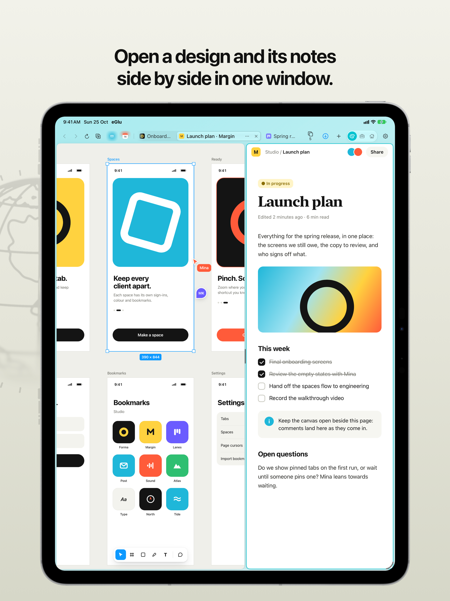
</p>

Two tabs side by side in one window, shown as one tab in the row, as in Dia. A click in a pane gives it the keys and the bars, the divider drags for more room on one side (a double tap puts it back in the middle), and both pages stay live.

- Open one from a tab's menu (**Open in Split View**), the **+** button's menu (**New Tab in Split View**), or press ⌃⌥\\.
- In a window narrower than two pages, only the pane with the keys shows.

### Spaces, each signed in on its own

<p align="center">
  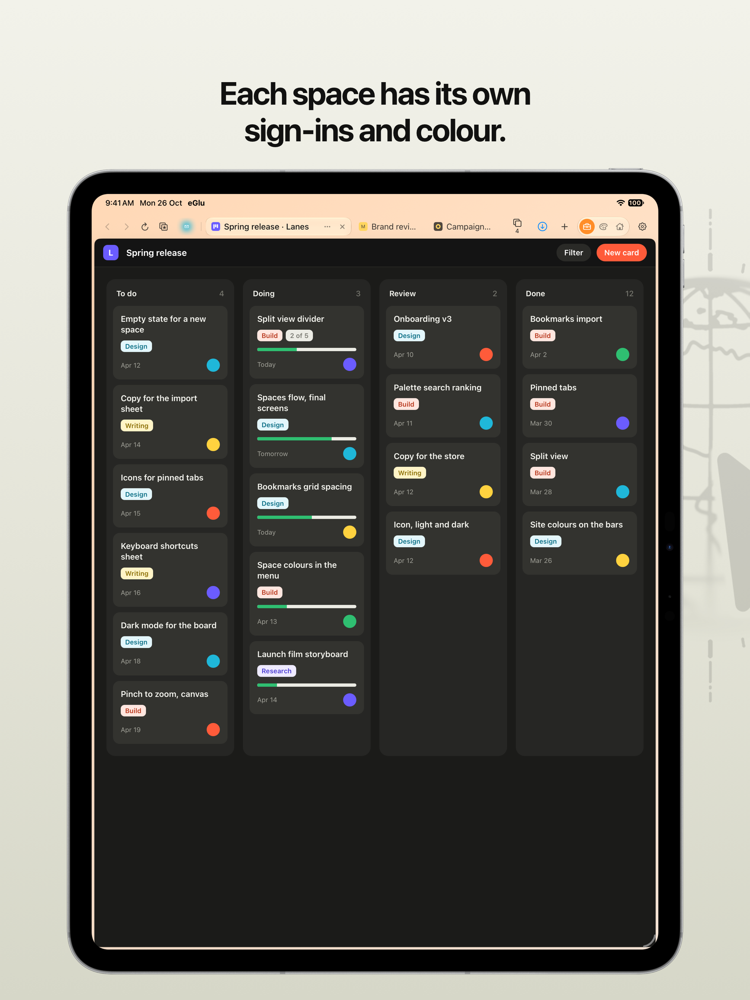
  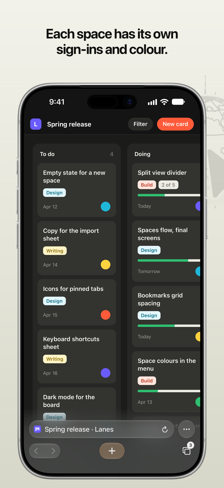
</p>

A space has its own tabs, its own cookies and sign-ins, and its own bookmarks. A client's Figma and your own can both stay signed in, one per space.

- **A colour and an icon fill each space's button**, so you can see which space a window is in.
- **New Space** is in the space button's menu, or press ⌃⌥⇧N. Space Settings (⌃⌥⇧S) sets the name, colour and icon; Settings › Spaces puts them in order.
- **Switch** with the space button, ⌃⌥↑ and ⌃⌥↓, or by typing the space's name in the command bar.
- Removing a space erases its sign-ins and site data.

### The command bar

<p align="center">
  
  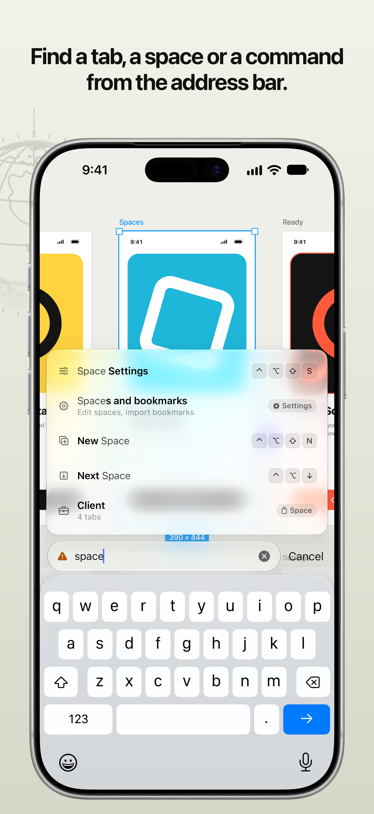
</p>

The address field and the command palette are one bar. On iPad it floats over the page, as Arc's and Spotlight's do; on iPhone it is the bar at the bottom.

- **⌘T or +** opens a new tab with the bar over it. **⌃⌥K** opens it without a new tab. A click on the address opens it holding the address.
- **Type to find anything**: an address or a search, an open tab in any space, a bookmark, a space, a command, or a part of Settings ("change icon", "ad blocker", "duckduckgo").
- **Every command shows its keys**, so the bar is also the cheat sheet of the shortcuts.
- **Suggestions as you type**, each row saying where it came from: an open tab, a pinned tab, a bookmark, a command, or the search engine. ↑, ↓ and Return choose one. An open tab is gone to rather than opened again.
- **With Apple Intelligence** (iOS and iPadOS 26), Apple's on-device model also finds tabs, bookmarks and commands by what your words mean, in any language it knows, and sends nothing anywhere.
- The search engine's suggestions come without cookies and never for an address you type. Settings › Search chooses the engine (Google, DuckDuckGo, Bing, Ecosia, Startpage, Kagi, Brave Search or Qwant) and turns suggestions off.

### Bookmarks on every new tab

<p align="center">
  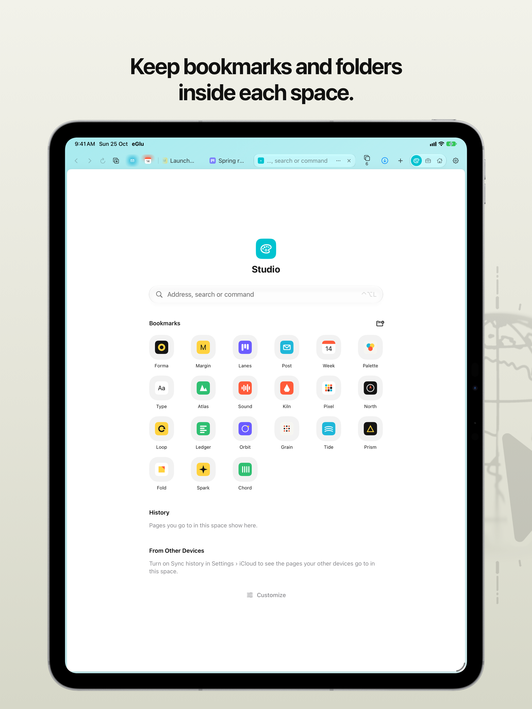
</p>

A new tab shows the space's bookmarks as a grid of site icons, folders and all.

- **Add or remove the page** with the star in the address, or ⌃⌥⇧D.
- **Folders**: the folder button by the heading makes one; a bookmark's menu has Rename… and Move to….
- **Import** from Chrome, Firefox or Safari (see [Bring your bookmarks](#bring-your-bookmarks)).

### Tabs that keep out of the way

- **One row, as Safari's compact layout.** The tab you are on shows where it is; click it and it becomes the address field, growing over the other tabs and shrinking back after. The other tabs sit beside it, flat. Settings can put the address bar under the tabs instead.
- **The bars take on the colour along the top of the page**, so bars and page read as one.
- **Pinned tabs, as in Dia and Arc.** A pinned tab is an icon at the front of the row that keeps its page: closing it unloads it and takes it back to the address it was pinned with. Pin or unpin with ⌃⌥⇧P or the tab's menu.
- **⇧⌘T** brings back the last tab you closed.

### On iPhone: the bar at the bottom

<p align="center">
  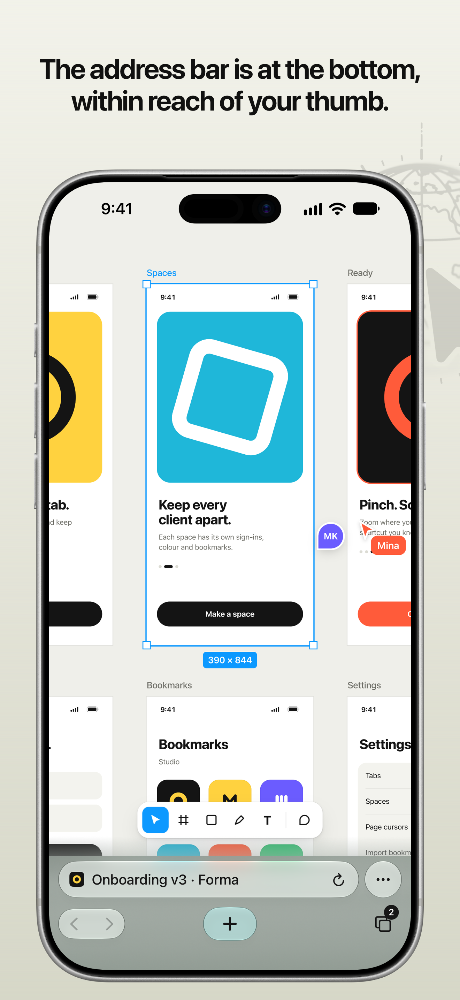
</p>

On a phone-width window (an iPhone either way up, a narrow iPad window) the bar moves to the bottom, where a thumb reaches: the address with the page's menu beside it, and under it back, forward, the space, a new tab and the tabs. Such a window gets mobile sites, with Safari's iPhone user agent, touch scrolling and pinch zoom; a window at least 600 by 500 points gets desktop sites.

- **Swipe up on the bar** for your tabs as cards, with your pinned tabs in a dock at the bottom. Swipe a card sideways to close it; touch and hold one for more.
- **Swipe sideways on the bar** to go to the tab beside, as in Safari.
- **Swipe from the screen's edge** to go back or forward, and **pull down** to reload.

### Desktop View on iPhone

<p align="center">
  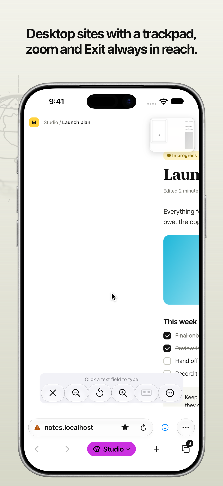
</p>

For a web app now and then on your phone. **Desktop View**, in the page's menu, lays the page out at an iPad Pro 13-inch's size and turns the screen into a trackpad, as Jump Desktop's trackpad mode does.

| Do | To |
|---|---|
| Move one finger | Move the cursor; the view follows it. Pushed against the top or bottom of the page, the cursor scrolls |
| Tap, or tap twice | Click, or double-click |
| Touch and hold, then move | Drag |
| Tap with two fingers | Right-click |
| Move two fingers | Scroll |
| Pinch | Zoom the view |
| Tap the minimap (top right) | Go to that part of the page; drag it to move it to another corner |
| Tap the keyboard button | Type into what you clicked |

Hover styles and the page's cursors show. Settings › Desktop View › Cursor speed sets how far the cursor goes. The clicks are script events, which a few sites ignore, and Google's sign-in stays on plain touch.

### iCloud sync

<p align="center">
  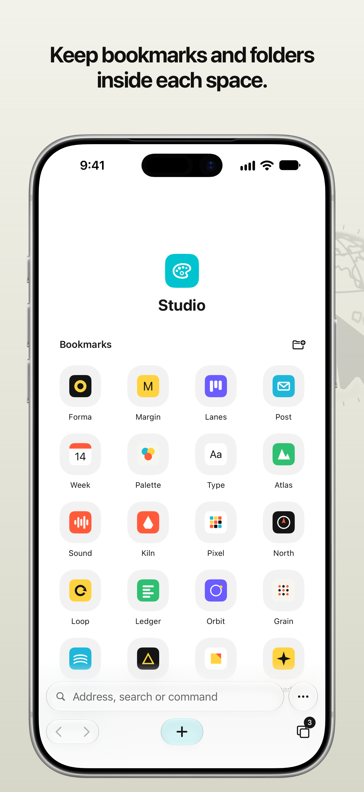
</p>

With Settings › iCloud on, each space's name, colour, icon, bookmarks and pinned tabs show on your other iPhones and iPads, and your open tabs show on them to pick up from, in the tab overview and the command bar. It uses CloudKit in your own iCloud, with no server of ours in between. Sign-ins, cookies and site data stay on each device.

With [Safience Sync for Chrome](#safience-sync-for-chrome), a Chrome profile joins in too.

### And more

- **Ads and trackers blocked** before they load, with WebKit's content blocker and the EasyList and EasyPrivacy lists. On by default. Allow a site with Block or Allow Ads on This Site (⌃⌥⇧A, or the site's menu), or turn it off in Settings › Ads and Trackers.
- **Memory spent on what you use.** One heavy tab (a Figma file) stays open while you look elsewhere; other tabs freeze to a picture and load again when opened. A page that runs out of memory reloads by itself.
- **Windows for Stage Manager.** Each window shows a space and a tab, and comes back as it was. ⌘N opens one.
- **Sign-in pages always show their address**, so you can see which site asks for your password. Google's sign-in is never touched: no script, no cookie read.
- **Passkeys, and Add to Home Screen.** Sites can use passkeys, and Share Page (⌃⌥S) puts Add to Home Screen in the share sheet.
- **Find on Page** (⌃⌥F) shows WebKit's find bar. ⌘F stays the page's.
- **A link's menu** (long press, or a secondary click on iPad): Open in New Tab, Open in Background, Copy Link and Share…. Never over a web app's own menu: 49 web apps that draw their own ship in a list, and Settings › Link menu adds or removes a site.
- **Links for other apps** (`mailto:`, `tel:`, an app's own link) open that app. When a page, not you, sends one, Safience asks first.
- **Eight app icons** to choose from in Settings › App icon.

## Safience Sync for Chrome

Safience Sync is a Chrome extension that pairs a Chrome profile with a space in Safience, through your own iCloud, with no server in between. It is in this repository, in [`Extension/`](Extension/).

| What | How it syncs |
|---|---|
| Bookmarks | Both ways. Chrome's bookmarks bar is the space's top level; Other Bookmarks is a folder of that name in it |
| Pinned tabs | Both ways. A tab pinned in Chrome is pinned in Safience; one pinned in Safience opens pinned in Chrome. Nothing is ever closed |
| Open tabs | Shown, never opened by themselves: Chrome's in Safience's tab overview and command bar, Safience's in the extension's popup |
| Never | Cookies, history, passwords, page contents. The extension has no access to pages at all |

It runs in Chrome, Edge, Brave, Vivaldi, Opera and other Chromium browsers, version 116 or later. Each Chrome profile pairs with a space of its own. In Dia and Arc, pinned tabs don't sync; bookmarks and open tabs do (see the [FAQ](#faq)).

### Install the extension

Safience Sync is not in the Chrome Web Store yet, and for now it is for developers. To reach your iCloud, it needs a CloudKit API token for the app's iCloud container, which only the container's owner can make in CloudKit Console, and this repository's copy has none. So it works with the App Store app only for the app's developer, or with a Safience you build from source with an iCloud container of your own (set `container` in `config.js` to match).

1. **Download this repository**: **Code › Download ZIP** on GitHub, then unzip it, or `git clone https://github.com/taehee-pd/Safience.git`.
2. **Check `Extension/config.js`.** It needs a CloudKit API token in `apiToken`, and `environment` must match the Safience you use: `production` for the App Store and TestFlight, `development` for a build run from Xcode. Without a token, the popup shows what to set up; [Extension/README.md](Extension/README.md) has the steps.
3. **Load it.** Open `chrome://extensions`, turn on **Developer mode** at the top right, click **Load unpacked** and choose the `Extension` folder.
4. **Pin it** to the toolbar: the puzzle-piece button › the pin beside Safience Sync.

### Pair a profile with a space

<table>
  <tr>
    <th>1. Sign in</th>
    <th>2. Choose a space</th>
    <th>3. Synced</th>
  </tr>
  <tr>
    <td valign="top">
      <picture>
        <source media="(prefers-color-scheme: dark)" srcset="Docs/images/extension-signin-dark.png">
        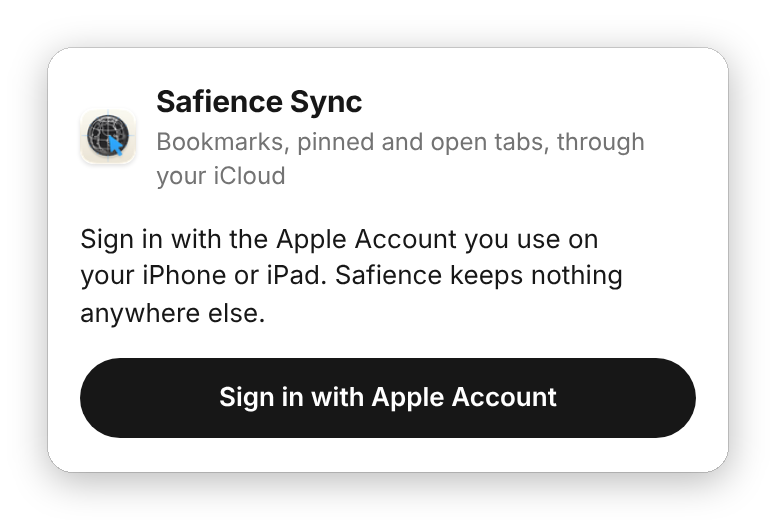
      </picture>
    </td>
    <td valign="top">
      <picture>
        <source media="(prefers-color-scheme: dark)" srcset="Docs/images/extension-pair-dark.png">
        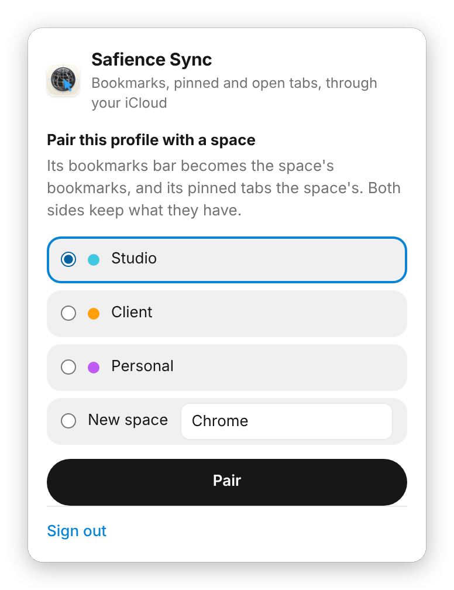
      </picture>
    </td>
    <td valign="top">
      <picture>
        <source media="(prefers-color-scheme: dark)" srcset="Docs/images/extension-paired-dark.png">
        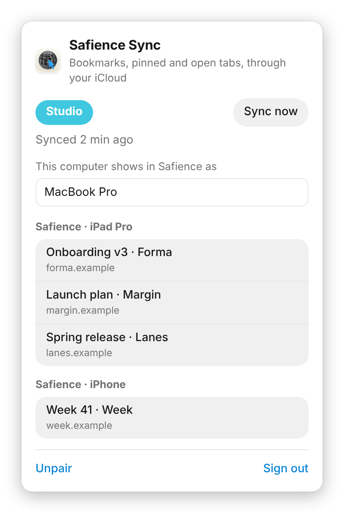
      </picture>
    </td>
  </tr>
</table>

1. **Sign in.** Click the Safience Sync button, then **Sign in with Apple Account**, and sign in with the Apple Account your iPhone and iPad use. Apple's own sign-in page opens; with "Keep me signed in" ticked, it lasts two weeks.
2. **Choose a space**, or choose **New space** and give it a name, then click **Pair**. Chrome's bookmarks and the space's are joined: the same address in the same folder is one bookmark, a folder matches one of the same name, and nothing is deleted on either side.
3. **That's it.** The popup shows the space, when it last synced and a **Sync now** button. It also shows the name this computer goes by in Safience (change it there) and Safience's open tabs on your other devices; click one to open it in Chrome.

In Safience, the profile's open tabs show in the tab overview and the command bar, under the browser and the computer's name ("Chrome · MacBook Pro").

### Several computers, one Chrome profile

Chrome Sync already carries a profile's bookmarks between its computers. So that each change reaches iCloud once, the first computer to pair writes the bookmarks and the others leave them to Chrome Sync. The popup on another computer says so, and **Sync bookmarks from this computer instead** moves the job there. Pinned and open tabs sync from every computer.

### Unpair or sign out

**Unpair** and **Sign out** are at the bottom of the popup. Unpairing stops syncing: the bookmarks and pinned tabs stay on both sides, and this computer's open tabs leave Safience.

### What it can reach

The extension asks Chrome for `bookmarks`, `tabs`, `tabGroups`, `storage`, `alarms` and `identity`, and talks to one host, `api.apple-cloudkit.com`. It can't read pages, cookies, history or passwords.

## Keyboard shortcuts

The browser's own shortcuts are ⌃⌥ (Control and Option), so ⌘, ⌥ and ⇧ stay the page's. The exceptions are the keys every browser keeps for itself and no page can count on: ⌘T, ⌘W, ⇧⌘T, ⌘N, ⇧⌘W, ⌃⇥ and ⌃⇧⇥ (the ones Chrome reserves from pages). Every shortcut is listed beside its command in the command bar, in Settings › Shortcuts, and in the menu bar on iPadOS 26.

⌃ Control · ⌥ Option · ⇧ Shift · ⌘ Command · ⇥ Tab

**Go**

| Keys | Command |
|---|---|
| ⌃⌥L | Open Address (the command bar holding the page's address) |
| ⌃⌥K | Find Anything (the command bar, everything listed) |
| ⌃⌥[ · ⌃⌥] | Back · Forward |
| ⌃⌥R · ⌃⌥. | Reload Page · Stop Loading |
| ⌃⌥S | Share Page… |
| ⌃⌥⇧M | Request Desktop or Mobile Site |
| ⌃⌥⇧A | Block or Allow Ads on This Site |
| ⌃⌥⇧L | Use or Leave This Site's Own Menus |
| ⌃⌥F | Find on Page… |

**Tabs**

| Keys | Command |
|---|---|
| ⌘T · ⌘W | New Tab · Close Tab |
| ⇧⌘T | Reopen Closed Tab |
| ⌃⌥⇧P | Pin or Unpin Tab |
| ⌃⌥\\ | Split or Separate Tabs |
| ⌃⌥⇧D | Bookmark This Page |
| ⌃⇥ · ⌃⇧⇥ | Next Tab · Previous Tab |
| ⌃⌥1 to ⌃⌥9 | A tab by its place; ⌃⌥9 the last |

**Spaces and windows**

| Keys | Command |
|---|---|
| ⌃⌥↓ · ⌃⌥↑ | Next Space · Previous Space |
| ⌃⌥⇧N | New Space |
| ⌃⌥⇧S | Space Settings |
| ⌃⌥⇧I | Import Bookmarks |
| ⌘N · ⇧⌘W | New Window · Close Window |
| ⌃⌥B | Show or Hide Tab Bar |
| ⌃⌥D | Show or Hide Diagnostics |
| ⌃⌥P | Give Keys Back to the Page |
| ⌃⌥, | Settings |

With VoiceOver on, ⌃⌥ is VoiceOver's key; type a command's name in the command bar instead.

## FAQ

<details>
<summary><b>Do I need an account?</b></summary>

No. Safience has no sign-in or account of its own. iCloud sync, if you turn it on, uses the Apple Account already on your device.
</details>

<details>
<summary><b>Why are the browser's shortcuts on ⌃⌥ and not ⌘?</b></summary>

Web apps use ⌘, ⌥ and ⇧ for their own shortcuts (Figma alone has hundreds), and a browser that took ⌘D or ⌘F would take them from the page. ⌃⌥ is a pair pages almost never use. Only the keys every browser keeps (⌘T, ⌘W, ⌘N and a few more) stay the browser's. The command bar shows every command's keys, so you don't have to learn them first.
</details>

<details>
<summary><b>Why do ⌘Tab, ⌘Space, ⌘H and the Globe key still go to iPadOS?</b></summary>

iPadOS keeps those, and its three- and four-finger gestures, for itself. No app can hand them to a page.
</details>

<details>
<summary><b>Can I stay signed in to two accounts of the same web app?</b></summary>

Yes: one space for each. Every space has its own cookie store, so a client's Figma and your own stay signed in side by side.
</details>

<details>
<summary><b>Do my sign-ins sync through iCloud?</b></summary>

No. Spaces, their bookmarks, pinned tabs and open tabs sync. Sign-ins, cookies and site data stay on each device, so you sign in to a site once on each one.
</details>

<details>
<summary><b>A site shows its mobile version on my iPad, or its desktop version on my phone. How do I switch?</b></summary>

Request Desktop or Mobile Site (⌃⌥⇧M, or type it in the command bar) asks the site for the other version, and Safience remembers your choice for that site. On iPhone, Desktop View in the page's menu shows the desktop version with the screen as a trackpad.
</details>

<details>
<summary><b>Why did a tab load again when I went back to it?</b></summary>

To save memory, Safience keeps one heavy tab (such as a Figma file) and two light ones live, and freezes the others to a picture that loads again when you open it. Under memory pressure it keeps none but the tab on screen.
</details>

<details>
<summary><b>How do I allow ads on a site, or turn ad blocking off?</b></summary>

Block or Allow Ads on This Site (⌃⌥⇧A, or the site's menu) allows one site. Settings › Ads and Trackers turns blocking off everywhere.
</details>

<details>
<summary><b>A web app's right-click menu is covered by the browser's. What do I do?</b></summary>

Use or Leave This Site's Own Menus (⌃⌥⇧L, or the page's menu) turns the browser's link menu off for that site. Settings › Link menu › Sites with their own menus lists the sites; 49 web apps are on it from the start.
</details>

<details>
<summary><b>Does Safience have extensions, a password manager, history or reader mode?</b></summary>

No. Passkeys work, and the Passwords app's AutoFill offers the passwords you saved there.
</details>

<details>
<summary><b>Why does Google's sign-in page act like plain Safari?</b></summary>

On accounts.google.com, Safience runs none of its own scripts and reads no cookies, so nothing it does can touch your Google sign-in. If Google refuses a sign-in, a banner points to signing in with email or SSO.
</details>

<details>
<summary><b>Do I need the Chrome extension?</b></summary>

Only if you want a Chrome profile's bookmarks and tabs in a space. Safience syncs between iPads and iPhones on its own.
</details>

<details>
<summary><b>Does the Chrome extension read my pages or history?</b></summary>

No. It has no access to pages, cookies, history or passwords. It reads the profile's bookmarks and the titles and addresses of its tabs, and writes them to your own iCloud.
</details>

<details>
<summary><b>Why aren't my pinned tabs in Dia or Arc synced?</b></summary>

Dia and Arc keep pinned tabs in a sidebar of their own, outside the tab strip that Chromium shows to extensions. Safience Sync sees every tab there as not pinned and can't pin one, so pinned tabs don't sync with these two browsers in either direction. Nothing in Safience or the extension can change that. Bookmarks and open tabs sync as they do in Chrome.
</details>

<details>
<summary><b>Something doesn't work on a site. How do I report it?</b></summary>

Open an [issue](https://github.com/taehee-pd/Safience/issues) with what you did, what you expected, what happened instead, your device and its iOS or iPadOS version, and the site. For anything about the trackpad or the keyboard, a screenshot of the Diagnostics panel (⌃⌥D) on that page helps. A security problem goes through [SECURITY.md](SECURITY.md) instead.
</details>

## Privacy

There is no server of ours, no analytics and no telemetry. Here is everything Safience keeps, and where:

| What | Where | Who can read it |
|---|---|---|
| Spaces, tabs and each space's bookmarks | `workspace.json` in the app's Application Support folder | You |
| The same, if iCloud sync is on | Your private CloudKit database | You |
| Ad-blocking lists | EasyList and EasyPrivacy as they shipped or as last downloaded, in `Filters/` in the app's Application Support folder, and WebKit's compiled rule lists | You |
| Sites' icons | The app's Caches folder, one per site: the icon a page names, fetched by the app without cookies, or carried in a Chrome bookmarks file | You. iPadOS may clear it |
| Pictures of frozen tabs, and what it takes to reopen them | The app's Caches folder; never for a sign-in page | You. iPadOS may clear it |
| Cookies, sign-ins, site data | One WebKit store per space, on the device | The sites that set them |
| Settings | The app's preferences | You |
| Anything else | Nowhere | |

Besides the pages you open and the searches you make, Safience sends requests on its own for three things:

- **Search suggestions**: what you type in the address bar goes to your search engine as you type, without cookies and never for an address. Settings › Search turns them off.
- **Sites' icons**: the icon a page you visited names, fetched without cookies.
- **Ad-blocking lists**: EasyList and EasyPrivacy from easylist.to, at most once every four days and only if they changed.

The privacy policy for the App Store, [PRIVACY.md](PRIVACY.md), lists everything that leaves your device.

## Known limitations

- iPadOS keeps its own shortcuts (⌘Tab, ⌘Space, ⌘H, the Globe key) and its three- and four-finger gestures. No app can hand those to a page.
- A synthetic event is marked `isTrusted: false`. A page that ignores untrusted wheel or key events can't be reached by the bridges; Validation's first check is that Figma isn't one.
- A frame from another site can't be reached by the wheel bridge; its events go to the frame's element in the page around it.
- A page's own cursor is drawn by the app, so it can trail the pointer by a frame. Cursors given by name (`ew-resize`, `crosshair`, `grab`) show the iPad's pointer, and the text beam is the iPad's own. Settings › Show pages' own cursors turns them off.
- A picture's menu is WebKit's own: the public API asks an app about a link's menu only. So it can't be given Open in New Tab, and at a secondary click the app can't hold it back for a page's own menu as it does a link's; a site that draws its own menus over pictures belongs in Settings › Link menu › Sites with their own menus.
- A swipe sideways on the trackpad goes back only on a page the bridge reaches. A page in a frame from another site, or one that takes the wheel without saying so (a passive listener that moves things itself), can't be told apart from a page with no use for the swipe.
- No extensions, password manager, history or reader mode.
- A bookmark of a site never opened in Safience shows the site's first letter until it is: its icon is fetched only from a page you open (Safari's export carries no icons, Chrome's does).
- Built without the browser entitlement (a fork, a personal team): no passkeys, and the Passwords app suggests nothing for a site, though it names the site in its AutoFill sheet.

## Build from source

### Build and run

Needs Xcode 26 or later and an iPad or iPhone on iOS or iPadOS 17 or later (iPadOS 26 or later recommended on iPad, for its menu bar).

1. Create `Config/Local.xcconfig` with your team ID: `DEVELOPMENT_TEAM = ABCDE12345` (Xcode › Settings › Accounts shows it). If the bundle identifier `net.taehee.safience` is taken, set `PRODUCT_BUNDLE_IDENTIFIER` there too. Git ignores the file.
2. Open `Safience.xcodeproj`, choose your device, press Run.

`project.yml` generates the project with [XcodeGen](https://github.com/yonaskolb/XcodeGen) (`brew install xcodegen`). After adding or removing a file, run `xcodegen` at the root and commit the regenerated project, so building needs only Xcode.

### With Apple's browser entitlement

Apple granted Safience its `com.apple.developer.web-browser` entitlement, and the app is signed with it (`Config/Safience.entitlements`, switched on in `Config/Signing.xcconfig`, which also holds the iCloud container and push for Settings › iCloud). With it:

- iOS and iPadOS offer Safience as the default browser (Settings › Apps › Default Apps › Browser App). Settings in the app says whether it is, and goes there.
- WebKit lets pages use passkeys on any site, runs service workers, and gives full script access on every domain.
- Share Page (⌃⌥S, or the tab's menu) hands the system's share sheet the web view itself, which puts Add to Home Screen in it.
- The app may not claim Universal Links for its own domains, and may not use the `Info.plist` keys Apple lists for browsers; `PolicyTests` keeps both so.

The entitlement is a managed capability: it has to be on for the app's identifier in Certificates, Identifiers & Profiles (Identifiers › `net.taehee.safience` › Capability Requests, or Additional Capabilities › Default Web Browser) before Xcode can make a profile with it.

A team without the entitlement (a fork, a personal team) can't sign with it. It turns the entitlements off in `Config/Local.xcconfig` with `CODE_SIGN_ENTITLEMENTS =`; the app then builds and runs as before, without passkeys, without being offered as the default browser and without iCloud sync.

### Tests

```
cd PadCore && swift test                    # PadCore; runs on macOS or Linux
node Tests/bridge.mjs                       # bridge.js in Chromium (needs Playwright)
node Tests/bridge.mjs webkit                # the same in Playwright's WebKit
node --test Extension/tests/model.test.mjs  # the Chrome extension's sync rules
```

`Tests/bridge.html` also runs on its own in Safari: `python3 -m http.server 8642` at the root, then open `http://localhost:8642/Tests/bridge.html`.

What only a real device can show (the trackpad, the keyboard, memory) is in [Validation/CHECKLIST.md](Validation/CHECKLIST.md), with the Diagnostics panel (⌃⌥D) to read along.

### Layout

| Path | What |
|---|---|
| `App/Sources/` | The app: UIKit for windows and gestures, SwiftUI for bars, the command bar and settings |
| `PadCore/` | Plain logic, no UIKit or WebKit: adapters, sign-in detection, the freezer, the workspace model, address parsing. Builds and tests on any machine with Swift |
| `PadCore/Sources/PadCore/Scripts/bridge.js` | The script that goes into pages |
| `Extension/` | Safience Sync for Chrome |
| `Tests/` | Browser tests for `bridge.js` |
| `Validation/` | What to check on a real iPad, and the Figma console test |
| `Marketing/` | The App Store's screenshots and text, and what makes them |
| `Docs/` | Design notes: [how each requirement is met, and where](Docs/Requirements.md), and [how sync works](Docs/SyncDesign.md) |
| `project.yml`, `Config/` | The Xcode project's source, and signing |

## Contributing

Small, focused changes are the easiest to take: one thing per pull request, readable start to finish. For anything bigger, open an issue first to say what you want to change and why. [CONTRIBUTING.md](CONTRIBUTING.md) has the details; in short:

- **The page gets the input.** A key or a gesture the system takes from a page is a bug, unless iPadOS keeps it for itself. The browser's own shortcuts are ⌃⌥ only.
- **Hands off Google's sign-in.** On a host in `HandsOff.swift`, no script of ours runs, no JavaScript is called and no cookie is read.
- **A site's needs go in its adapter** (`PadCore/Sources/PadCore/Adapters.swift`), not in the app.
- **No dependencies** beyond Apple's frameworks.
- **Nothing leaves the device** but the pages you open.
- **A change that fixes or adds something adds its line** under Unreleased in [CHANGELOG.md](CHANGELOG.md).

## Security

Safience holds your sign-ins to the tools you work in, so a hole in it matters more than most bugs. Please report one privately, through the repository's **Security** tab › [**Report a vulnerability**](https://github.com/taehee-pd/Safience/security/advisories/new), and not in a public issue. [SECURITY.md](SECURITY.md) says what counts and how to report it.

## Disclaimers

- Safience is an independent project. It is not made, endorsed or supported by Apple, Google, Figma or any other company whose products it works with or names.
- Safience shows whatever site you open, as Safari does. A site, its sign-in page and its content belong to whoever runs it, not to Safience.
- The bridges that hand the trackpad and keys to a page work with sites as they are built today. A site can change in a way that stops one from working; Safience can't promise that any site works in it.
- The web apps in the screenshots (Forma, Margin, Lanes and the others) are mock-ups made for them, not real products.
- Safience is provided as it is, without warranty of any kind, as the [MIT license](LICENSE) says.
- Apple, the Apple logo, iPad, iPhone and Safari are trademarks of Apple Inc., registered in the U.S. and other countries and regions. App Store is a service mark of Apple Inc. Chrome is a trademark of Google LLC. Figma is a trademark of Figma, Inc. Other names are the trademarks of their owners.

## Credits

- Safience began as a fork of [Search](https://github.com/driceroland/Search), a WebKit browser for the Mac by Office Commun, released under the MIT license. The Mac app was removed when Safience became an iPad app and stays in this repository's git history; Safience keeps its address parsing (`Address.swift`, `Engine.swift`, `Registrable.swift`) and its quiet grey colours. "Search" and its icon are Office Commun's.
- The ad and tracker lists are [EasyList and EasyPrivacy](https://easylist.to), by the EasyList authors, under CC BY-SA.

## License

MIT, see [LICENSE](LICENSE).
